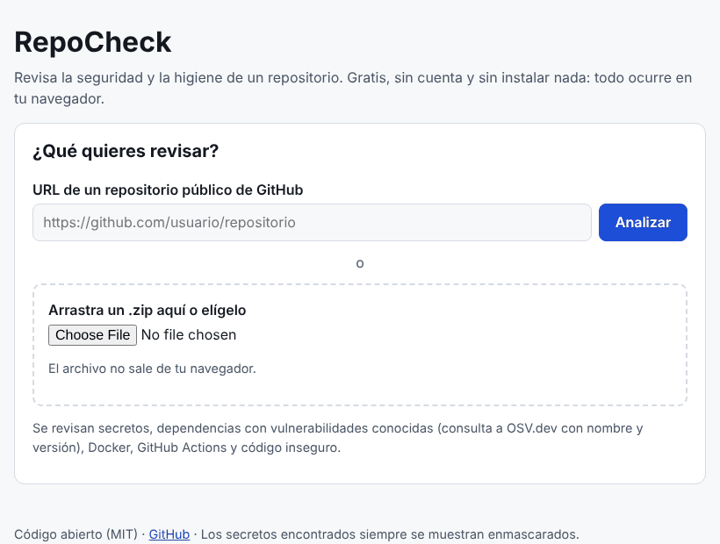

# RepoCheck

[](LICENSE)


**Revisa tu repo antes de publicarlo.**

RepoCheck analiza un repositorio público de GitHub o un archivo zip, en cualquier lenguaje, y entrega un reporte de seguridad e higiene con nota de A a F. Todo corre en el navegador: sin servidor, sin base de datos, sin cuenta y sin que el zip salga de tu equipo.

**Pruébalo:** https://isaidardonmayen.github.io/RepoCheck/



## Qué revisa

- Dependencias con vulnerabilidades conocidas (contra [OSV.dev](https://osv.dev); solo se envían nombre y versión).
- Secretos expuestos: llaves, tokens y contraseñas, siempre enmascarados en el reporte.
- Higiene del repo: archivos de compilación versionados, binarios, `.env`, `.gitignore`, README y licencia.
- Dockerfile, docker-compose y workflows de GitHub Actions.
- Código inseguro, con reglas propias para JavaScript/TypeScript, Python, Java, C#, PHP, Go, C/C++ y Ruby.

Funciona con cualquier lenguaje en tres niveles: las revisiones universales siempre aplican, la detección cubre ~70 lenguajes (de los modernos a COBOL), y el análisis de código se activa donde hay reglas. Lo que no se pudo analizar, el reporte lo dice. Son reglas heurísticas: pueden fallar y no reemplazan una auditoría.

## Descargas

El reporte se puede bajar en HTML, PDF, JSON y Markdown, y hay una insignia (SVG o Markdown para tu README) con tu nota.

## Cómo está organizado

```text
packages/
  core/     motor en TypeScript, sin dependencias del DOM
  rules/    tabla de lenguajes y reglas como datos (JSON)
  web/      interfaz en Angular
spikes/     pruebas de viabilidad
docs/       decisiones (ADR), roadmap, backlog y retrospectivas
```

Más detalle en [docs/architecture.md](docs/architecture.md) y en el [roadmap](docs/roadmap.md).

## Cómo trabajo en este proyecto

Scrum ligero con sprints de dos semanas, todo visible en GitHub: historias de usuario como issues, un milestone por sprint, decisiones de arquitectura en [docs/adr](docs/adr) y retrospectivas en [docs/retros](docs/retros). Las reglas del flujo están en [CONTRIBUTING.md](CONTRIBUTING.md).

## Ejecutarlo en local

Requiere Node 20 o superior.

```bash
git clone https://github.com/IsaiDardonMayen/RepoCheck.git
cd RepoCheck
npm install
npm run check   # lint, tipos y pruebas
npm run dev     # la app en http://localhost:4200
```

## Seguridad

RepoCheck lee contenido de terceros, así que su propia seguridad es parte del producto. Nunca ejecuta el código que analiza. Lee [SECURITY.md](SECURITY.md) para el modelo de amenazas y para reportar una vulnerabilidad.

## Licencia

[MIT](LICENSE) © 2026 Isai Dardón Mayén
