# Arquitectura

Todo el análisis ocurre en el navegador. Solo salen consultas a GitHub (archivos del repo) y a OSV.dev (nombre y versión de cada dependencia). Ver [ADR 0001](adr/0001-app-en-el-navegador.md).

```mermaid
flowchart TD
    subgraph Navegador["Navegador de la persona"]
        Entrada["Entrada<br/>URL de repo público o zip"] --> Cargador
        Cargador["Cargador<br/>árbol + archivos clave, o zip en memoria"] --> Worker
        subgraph Worker["Web Worker"]
            Detector["Detector de lenguajes<br/>languages.json"] --> Universal["Revisiones universales<br/>secretos, higiene, Docker, workflows"]
            Universal --> PorLenguaje["Revisiones por lenguaje<br/>dependencias y reglas JSON"]
        end
        Worker --> Nota["Motor de nota<br/>severidad a puntaje A-F"]
        Nota --> Reporte["Reporte y descargas<br/>HTML, PDF, JSON, Markdown"]
    end
    Cargador <-->|"árbol y raw"| GitHub[("GitHub")]
    PorLenguaje <-->|"querybatch"| OSV[("OSV.dev")]
```

## Paquetes

| Paquete | Responsabilidad | Estado |
| --- | --- | --- |
| `@repocheck/core` | Tipos de hallazgos, nota, enmascarado y, más adelante, analizadores | Sprint 0: tipos, nota y enmascarado |
| `@repocheck/rules` | Tabla de lenguajes y reglas como datos | Sprint 0: tabla de lenguajes |
| `web` | Interfaz en Angular | Sprint 5 |
| `cli` | Línea de comandos y GitHub Action | Versión 1.1 |

## Reglas de diseño

1. `core` no usa ninguna API del DOM.
2. Todos los módulos devuelven la misma estructura `Finding`.
3. Ningún secreto sale de un analizador sin enmascarar.
4. Todo texto que viene de un repo analizado se escapa antes de mostrarse.
5. El contenido analizado se lee como texto y nunca se ejecuta.
